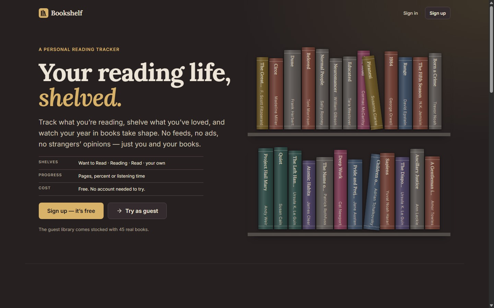

# Bookshelf — jonghwascript

A personal reading tracker where you search for books, organize them into shelves, track reading progress, and explore year-in-review statistics. Your reading life, beautifully organized.

| | |
|---|---|
| **Live site** | https://jonghwascript.github.io/personal-reading-list/ — guest library: https://jonghwascript.github.io/personal-reading-list/guest |
| **Repository** | https://github.com/jonghwascript/personal-reading-list |
| **Challenge** | [Personal reading list (Bookshelf) — Frontend Mentor Product Challenge](https://www.frontendmentor.io/challenges/personal-reading-list) |
| **Author** | [github.com/jonghwascript](https://github.com/jonghwascript) |



---

## Overview

Bookshelf is a full-stack React app. Visitors can open a fully stocked **guest library** in one click — 45 real books across five genres, spread over shelves with progress, ratings, notes and a reading goal — or sign up to keep a library of their own in Supabase.

What you can do:

- **Find books** on Open Library by title, author or ISBN, with edition-aware duplicate detection ("In your library") and an edition picker when a work has several editions.
- **Organize** books on three default shelves plus your own; drag books between shelves (mouse, touch or keyboard), reorder shelves, sort and filter with animated re-layout.
- **Track progress** in pages, percent (e-books) or listening time (audiobooks), straight from the dashboard, with undo and an explicit "Mark as finished".
- **Set a yearly goal** and see whether you're ahead, on track or behind.
- **Look back** on any year with the year in review, and share it as an image.

### Tech Stack

| Layer | Technology |
|-------|-----------|
| Framework | React 19 + TypeScript, Vite 8, React Router 7 |
| Database | Supabase Postgres with row-level security (migrations in `supabase/migrations`) |
| Authentication | Supabase Auth — email + password, password reset; guest mode in `sessionStorage` |
| Book API | Open Library (search, works, editions, covers) — throttled to 1 req/s, cached |
| Hosting | GitHub Pages via GitHub Actions (`.github/workflows/deploy-pages.yml`); `vercel.json` also included |
| Styling | CSS Modules + design tokens (`starter/tokens.css`) |
| Charts/Viz | Hand-built CSS/SVG charts; Canvas API for the shareable year card |
| Other | GSAP (Flip, ScrollTrigger), @dnd-kit/core, lucide-react, Vitest + Testing Library |

---

## Design Decisions

These are the product and design choices I made where the spec left room for interpretation.

I designed the three features in the order a reader meets them: **discovery** fills the library, **progress tracking** gives a reason to come back while reading, and the **year in review** makes the accumulated record worth revisiting. Deciding *what progress data to store* first also decided what story the review could honestly tell.

| Feature | Direction | Trade-off I accepted |
|---|---|---|
| Year in review | A dedicated page that opens on covers and one sentence; monthly chart and the full list below | Fewer headline metrics, but a reader with 3 books still gets *their* story |
| Discovery | Search + curated lists on an empty library; explainable "same genre as…" suggestions once there's history | Early suggestions aren't deeply personal, but nobody fills in a taste quiz before adding a first book |
| Progress | Log the last position straight from the dashboard card | Fast to enter, but log timestamps can't tell real reading time or speed |

### Year-in-Review & Reading Insights

**The problem I was solving:** Raw totals flatter heavy readers and embarrass light ones. A page of zero-filled charts in March is a bad moment.

**My approach:** `/review` starts with the books themselves. Up to six finished books are *all* the heroes — large covers, each labelled with the month it was finished, under a sentence like "You finished these three books so far this year." Beyond six, it shows a fan of highlights (highest-rated first) and names the standout month ("March was your biggest month…"). Below: a month-by-month chart (with a screen-reader table), then genre and page totals, then every book in finishing order.
- The current year is labelled **"2026 so far · as of November 20"**; past years **"Your 2025 in books"**.
- Genres appear only when ≥ 3 finished books have genre data; the page total only when ≥ 70% of books have a known length (and says how many it's based on). A half-known number would mislead.
- A year with nothing finished shows no charts — it links back to the book you're reading instead.
- Sharing produces a 1080×1080 image. You **preview it and tick exactly which covers appear** before downloading; no ratings or notes are included.
- As you scroll, the headline counts up, month bars grow from the baseline and each month of the list rises into view (GSAP ScrollTrigger; off under reduced motion).

**Why I chose this approach:** Covers are the most personal, recognisable thing in a reading year, and they scale gracefully from 3 to 50. A distinct deep-ink hero with oversized serif numerals makes it feel like a special moment rather than another dashboard.

**What I'd do differently:** A shareable public link (not just an image) and a month drill-down from the chart.

### Book Discovery & Recommendations

**The problem I was solving:** A search box isn't discovery, and an empty library is a dead end for anyone who doesn't already know what to add.

**My approach:** The empty library shows a search box ("Search for a book you've read or want to read") and three hand-curated lists — *Short novels for a weekend*, *Made for book club conversations*, *Ideas that change how you work*. The page stays in this "getting started" layout until the reader has three books, so adding several in a row never makes the layout jump or lose focus. The same lists live on **Discover**, alongside a recommendation row that always shows its reason: "Same genre as *Ancillary Justice* — because you rated it 4★".

Search results and curated books are 145×214 cards on the same grid as the library: cover, title, author, then year, typical length and edition count, with the add button pinned to the bottom of each card so buttons line up across a row. **One edition → one click to "Want to Read". Several editions → one extra, pre-answered step:** a dialog listing editions with page counts, format, publisher and language, with "Not sure yet — use the typical length" selected by default.

*Why a dialog here, when the brand guidance says not to use modals for routine actions?* I first built the chooser inline, expanding the card across its row; once results became narrow cover cards, that broke the grid. Adding a single-edition book — the routine case — still never opens anything. The dialog is native `<dialog>`, so focus is trapped, Escape and the backdrop close it, and focus returns to the button. It has a fixed height, so editions arriving mid-animation don't make it grow and jump.

**Why I chose this approach:** Curated lists solve the cold start with zero data and zero API calls (they're stored with real Open Library ids). Explainable recommendations need only one loved book. I added friction in exactly one place — the edition choice — because **the edition decides the page count every progress percentage is computed from** (Open Library lists *Circe* editions of 336 and 696 pages).

**What I'd do differently:** Let readers collapse the edition step permanently ("always use typical length"), and broaden recommendations beyond a single seed book.

### Reading Progress Tracking UX

**The problem I was solving:** Progress updates happen constantly, so they must take seconds — yet the data must be trustworthy enough for goals and the review.

**My approach:** Each Currently Reading card shows the position in the reader's own unit — `147 / 350 pages`, `35%`, or `1h 44m of 5h 18m` — a bar with subtle 50% / 90% ticks, and a **Log progress** button. That opens a single inline field ("Last page read"), saves optimistically, shows a short line ("Halfway there. Saved.") and an **Undo** for eight seconds. Reaching the last page doesn't silently finish the book: it asks **"Mark as finished?"**, and confirming moves it to *Read*, stamps the date and updates the goal and review together.
- **Formats:** print tracks pages, e-books percent, audiobooks minutes. When the total is unknown the position is still saved ("Page 147"), with a prompt to add the edition's length for a percentage.
- **What's stored:** each logged position and its timestamp. I deliberately **don't** derive streaks or reading speed from timestamps — people often log a session hours or days later. "Time to finish" is shown only when both a start and finish date exist.

**Why I chose this approach:** One input per session keeps it effortless; one explicit confirmation at the end protects the data that goals and the review depend on. Undo replaces "edit history" forms.

**What I'd do differently:** Optional reading sessions (start/end page with a date picker) for readers who *do* want pace statistics.

### Other Design Choices

**Palette.** I replaced the brand kit's amber/brown palette with a softer one built from [Color Hunt #FFB6B9 · #FAE3D9 · #BBDED6 · #61C0BF](https://colorhunt.co/palette/ffb6b9fae3d9bbded661c0bf) (pink, peach cream, mint, teal). The four source colours are pastels, so I used them as surfaces and highlights — peach cream for page backgrounds, mint for selected states, pink and teal glowing through the year-in-review hero — and derived deeper shades of the same hues for text and controls (teal `#1A7372` for links and buttons, rose `#D9667A` for star ratings). In dark mode the original teal and pink become the accents on a deep teal night. A unit test (`src/styles/tokens.test.ts`) reads `starter/tokens.css` and checks every text/background pairing against WCAG AA in both modes, so the palette can't silently regress.

**Covers.** Every cover in the app shares one 145:214 portrait ratio; library and discovery grids use fixed 145px columns, so wider screens get more books per row rather than bigger covers. Missing covers get a hand-set placeholder (title and author in Lora on a muted spine colour) instead of a broken image, and Open Library's 1×1 "no cover" pixel is treated as missing.

**Motion.** CSS handles hovers and simple transitions; GSAP handles choreography — the landing intro, shelf re-layout (Flip), the year-review scroll story (ScrollTrigger), search results staggering in, and dialogs that ease in and out. Everything is skipped under `prefers-reduced-motion`.

**Navigation.** A sidebar on desktop (shelves with counts double as drag-and-drop targets) and a bottom bar on mobile; focus moves to each page's heading on navigation, behind a skip link.

---

## Development Journey

### Initial Approach vs. Final

I started with the foundation: a repository interface with two implementations (an in-memory guest library and Supabase), so the whole app worked without credentials from day one, and an Open Library client with throttling, caching and typed errors. The three design challenges came next, then the animated-shelf differentiator. The final app kept that architecture; what changed most was the presentation layer — card layouts, the palette and the motion system.

### Decisions Reconsidered

- **Edition picker:** inline expansion inside the card → a native dialog, once cards became narrow vertical cards.
- **Palette:** I tried several palettes (a rebalanced pink/mint with a rose accent, a neon-cyan dark mode, an orange/sky pastel, a custom dark background) and came back to the first pink/mint version.
- **Hover effects:** a simple lift on Discover covers → one shared `TiltCover` component used by every cover grid.
- **Animation:** CSS-only → GSAP for the parts that are choreography rather than state transitions.
- **Empty library:** switching straight to the dashboard after the first book made the page jump and lose focus; it now stays in a "getting started" layout until three books are added.

### What Surprised Me

- **Open Library's data really is messy:** merged works come back as redirects, cover endpoints return a 1×1 pixel instead of a 404 unless you ask, and popular works have hundreds of editions with very different page counts.
- **A background bug surfaced through an unrelated feature:** the lazily loaded Supabase SDK rebuilt the guest repository when it arrived, remounting the page. Adding drag-and-drop shifted the timing enough for an end-to-end test to catch it.
- **Supabase tables created via SQL needed explicit `GRANT`s** for the `authenticated` role (`permission denied`, 42501) even with RLS policies in place.
- **Small CSS resets have reach:** `* { margin: 0 }` silently un-centred every modal dialog.

### Session Breakdown

| Session | Focus | What I Accomplished |
|---------|-------|-------------------|
| 1 | Foundation | Vite + React + TS setup, domain model, Open Library client, guest seed, Supabase schema and RLS, core screens |
| 2 | Database | Verified Supabase against a live project with an opt-in integration test (RLS isolation between two users); added explicit grants |
| 3 | Design challenges | Reading formats and progress logging with undo, curated discovery and explainable recommendations, edition chooser, year in review and share card |
| 4 | Visual identity | Palette exploration and WCAG contrast test; brand kit updated to match |
| 5 | Differentiator | Drag-and-drop between shelves with keyboard support; first commits with each commit building and testing on its own |
| 6 | Layout polish | 145×214 covers everywhere, vertical discovery cards with aligned buttons, shared 3D cover tilt |
| 7 | Motion | GSAP landing intro, Flip re-layout, year-review scroll story, search and dialog animations |
| 8 | Ship | Edition dialog, GitHub Pages deployment (base path, SPA fallback, Actions workflow) |

---

## AI Collaboration Reflection

### How I Used AI

I built this with Claude Code as a pair programmer across planning, implementation, testing and git hygiene. I made the product calls — the stack (Supabase, React + Vite, CSS Modules), the differentiators, the direction for each design challenge, the palette, the card sizes and when to use a dialog — and the AI implemented them, wrote tests, and reported what it had and hadn't verified.

### What Worked Well

- **Writing the design direction down first** (a short brief per design challenge) and letting the AI implement against it.
- **Asking for evidence:** every change ran type-checks, unit/integration tests and a production build; commits were verified one by one in a clean worktree.
- **Measuring instead of guessing:** for the dialog animation, measuring the dialog's size and position frame by frame showed the real cause of the jank (content arriving mid-animation), not the easing curve.

### What I Learned

Short, concrete feedback ("the buttons should line up at the bottom", "the modal should be centred", "opening should be faster") produced the best iterations. Visual quality still needs a human looking at the screen: the AI's browser screenshots often failed, so I checked the UI myself.

### Where I Pushed Back

- Kept the first palette after trying several alternatives.
- Asked for a modal edition picker even though the brand guidance discourages modals for routine actions; we kept single-edition adds modal-free and documented the trade-off.
- Asked to unify all cover hover effects instead of keeping a lighter variant on Discover.

---

## Differentiators

### Chosen Differentiator(s)

**1. Animated Shelf & Cover Interactions**

**Why I chose this:** Books are physical objects; moving one between shelves should feel like it.

**How it enhances the product:** Books can be dragged from any shelf preview onto another shelf section, or onto a shelf name in the sidebar. The cover lifts and tilts in hand, every other shelf shows a dashed outline, the one underneath lights up ("Drop to move to Read"), and the book settles onto its new shelf with a small spring. A toast confirms the move with **Undo**, which restores the book exactly (dates and progress included). Covers tilt toward the cursor on hover, sorting and filtering glide books to their new places, and goal completion gets a confetti moment.

**Implementation highlights:**
- `@dnd-kit/core` with mouse, touch (long-press, so scrolling still works) and **keyboard** sensors. Keyboard dragging steps *shelf by shelf* rather than pixel by pixel: Space picks a book up, ↑/↓ choose a shelf, Space drops, Esc cancels — Enter still opens the book.
- Cards stay real links: dnd-kit's `role="button"`, `aria-pressed` and "draggable" role description are stripped, and the drag instructions are attached with `aria-describedby`; every pick-up, hover and drop is announced.
- Dropping on *Read* or *Currently Reading* applies the same rules as any other move (finish/start dates, progress), so drag-and-drop can't create inconsistent data.
- **GSAP** for choreography CSS can't express well (hovers and simple transitions stay in CSS): **Flip** glides books to their new places when a shelf is sorted or filtered, **ScrollTrigger** turns the year in review into a calm scroll story, and timelines drive the landing intro, search results and dialogs. Counting numbers are `aria-hidden` duplicates so screen readers hear the final value at once; ScrollTrigger lives only in the year-review chunk.
- Every animation respects `prefers-reduced-motion` (static highlight instead of the spring; GSAP checks it via `canAnimate()` and simply doesn't run).

**What I learned:** Adding the drag layer exposed an unrelated bug: when the auth SDK finished loading in the background it rebuilt the guest repository and remounted the page under the reader. Splitting the guest and account repositories (and refreshing an on-screen library in place) fixed it.

**2. Accessibility-First Reading Tracker**

**Why I chose this:** Books are for everyone, and a reading app is used for long stretches — comfort settings matter as much as compliance.

**How it enhances the product:** Beyond WCAG AA everywhere, readers can tune the app in **Account → Appearance & reading**: theme, **high contrast (WCAG AAA, ≥ 7:1 text)**, text size (112.5% / 125%), relaxed line and letter spacing, and the **OpenDyslexic** font — with a live preview. Choices are applied before first paint, and "System" follows the OS (`prefers-color-scheme`, `prefers-contrast`). A public [accessibility statement](https://jonghwascript.github.io/personal-reading-list/accessibility) lists what's built in, how it was checked and the known gaps.

**Implementation highlights:**
- Keyboard: `/` or Ctrl/⌘K searches the library from anywhere; arrow keys, Home and End move between books in a grid; `1`–`5` rate the open book (`0` clears); drag-and-drop works with Space and arrows.
- Focus moves to each new page's heading (or the field the page is for); live regions announce saves, moves, undo and search counts.
- Automated tests read the colour tokens and fail if any text/background pair drops below 4.5:1 — or 7:1 in high contrast — in light and dark.
- Measured in a real browser: no horizontal scrolling at 320px on every main screen (fixing two overflows — the year-review month chart and the statement's shortcut table — that the measurement found).
- OpenDyslexic is a separate chunk, fetched only by readers who choose it.

**What I learned:** Claims need measurements. Writing the statement surfaced two things I had assumed and was wrong about (all touch targets 44px; no overflow at 320px), and both were corrected before publishing. Screen-reader testing with NVDA/VoiceOver is the honest next step.

---

## Self-Assessment

Rate your implementation honestly. This self-awareness is part of the portfolio artifact.

<!-- Ratings are mine to fill in after testing the deployed site. -->

| Category | Rating | Notes |
|----------|--------|-------|
| **Works for real users** — Deployed, functional end-to-end | /5 | Guest mode needs no setup; accounts need the Supabase variables in the deploy |
| **Book API integration** — Handles missing covers, varied ISBNs, inconsistent metadata | /5 | Throttle + cache, typed errors, edition-aware duplicates, 1×1-pixel covers treated as missing |
| **Design-it-yourself features** — Quality and thoughtfulness of year-in-review, discovery, and progress tracking solutions | /5 | |
| **Design quality** — Typography pairing, warm aesthetic, spacing, visual hierarchy, polish | /5 | |
| **Responsive design** — Fully functional and well-designed across devices | /5 | |
| **Performance** — Fast load, smooth scrolling, efficient cover image loading | /5 | Route-level code splitting; Supabase SDK loaded lazily; main bundle ≈ 178 KB gzip |
| **Accessibility** — Keyboard nav, screen reader support, contrast | /5 | AA contrast tests in both themes, AAA high-contrast mode, reading settings, keyboard shortcuts; not yet screen-reader tested |
| **Edge case handling** — Empty states, errors, loading, missing data, large libraries | /5 | |
| **Code quality** — Clean, maintainable, well-structured | /5 | 124 unit/integration tests plus an end-to-end flow test |
| **Landing page** — Compelling, communicates value, visually polished | /5 | |
| **Guest experience** — Immediately impressive, real books, full features | /5 | |

### Lighthouse Scores

Measured with Lighthouse on the deployed site (https://jonghwascript.github.io/personal-reading-list/). Mobile mode simulates a slower network and CPU, so its scores run lower.

| Category | Desktop | Mobile |
|----------|---------|--------|
| Performance | 93 | 86 |
| Accessibility | 100 | 100 |
| Best Practices | 96 | 92 |
| SEO | 100 | 91 |

### Strengths

- The guest library is immediately explorable and the whole app works without any backend configured.
- Design decisions are backed by data rules (edition length drives progress; the review only claims totals it can support).
- Accessibility is built in rather than bolted on: keyboard drag-and-drop, announcements, contrast tests, reduced-motion support.

### Areas for Improvement

- Stretch features not yet built: Goodreads CSV import, activity timeline, bulk actions.
- Real-device testing on the deployed site. Lighthouse clears every target on desktop (93 / 100 / 96 / 100) and mobile (86 / 100 / 92 / 91), but mobile performance has the least headroom over the 85 target.
- Main bundle size: GSAP is in the main chunk because the landing intro must run before first paint.

---

## Known Limitations

- **Shared catalog writes:** any signed-in user can insert or update rows in the shared `books` catalog (by design, for de-duplication); a server function would be safer.
- **Whole-library load:** an account's library is loaded in one go — fine for hundreds of books, but it doesn't page.
- **Auth email:** Supabase's built-in email service only delivers to project team members and is rate-limited; production needs custom SMTP.
- **Currently Reading cards** use a smaller cover (88px) than the 145px grids.
- **Year review sharing** produces an image only, not a public link.
- **Screen readers:** not yet tested with NVDA, JAWS, VoiceOver or TalkBack.

---

## Running Locally

```bash
# Clone the repo
git clone https://github.com/jonghwascript/personal-reading-list.git
cd personal-reading-list

# Install dependencies
npm install

# Optional: connect Supabase for accounts (guest mode works without it)
cp .env.example .env
# Fill in your Supabase project URL and publishable (anon) key,
# then run supabase/migrations/0001–0003 in the Supabase SQL editor.

# Run the development server
npm run dev

# Tests and production build
npm test
npm run build
```

### Environment Variables

| Variable | Description |
|----------|------------|
| `VITE_SUPABASE_URL` | Supabase project URL (`https://<ref>.supabase.co`). Optional — without it the app runs guest-only. |
| `VITE_SUPABASE_ANON_KEY` | Supabase publishable (anon) key. Public by design; it ships in the browser bundle. |
| `BASE_PATH` | Build-time base path. Unset (`/`) locally and on Vercel; the Pages workflow sets `/personal-reading-list/`. |
| `RUN_SUPABASE_IT` | Set to `1` to run the live Supabase integration test (creates two throwaway users; needs "Confirm email" off). |

### Deployment

Pushing to `main` runs `.github/workflows/deploy-pages.yml`: install → test → build with the Pages base path → publish to GitHub Pages. Repository settings needed once: **Pages → Source: GitHub Actions**, and the two `VITE_SUPABASE_*` values as **Actions variables**. In Supabase, add the Pages URL to **Authentication → URL Configuration**.

---

## Acknowledgments

Built as a [Frontend Mentor Product Challenge](https://www.frontendmentor.io/challenges/personal-reading-list). Book data and covers from [Open Library](https://openlibrary.org). Colour palette from [Color Hunt](https://colorhunt.co/palette/ffb6b9fae3d9bbded661c0bf).
